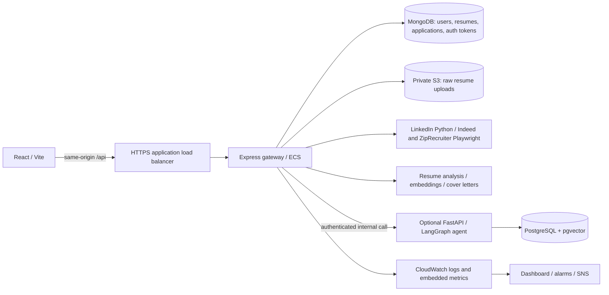

# GradHunt architecture and operational model

GradHunt helps early-career applicants find jobs, turn resumes into structured profiles, rank listings, generate cover letters, and track applications. The current application is a React client with an Express gateway. The newer Python service adds resume optimization through LangGraph; it is an optional integration rather than a replacement for the gateway.

| Component | Source | Responsibilities and operational dependencies |
| --- | --- | --- |
| Client | `frontend/src/App.jsx`, components | Search, uploads, resume history, auth, details, cover letters, application tracking. Auth token lives in browser local storage. Vite proxies `/api` in development; production uses the gateway origin. |
| Gateway | `backend/app.js`, `server.js`, routes/controllers | HTTP contract, production configuration checks, auth, body limits, health endpoints, metrics, static SPA, graceful shutdown. |
| Search | `jobAggregationService.js`, `scrapers/companyScrapers.js` | Expand resume-derived searches to at most three roles; collect LinkedIn/Indeed/ZipRecruiter; deduplicate exact and fuzzy keys; filter employment type and applied jobs; rank and paginate 18 at a time. |
| Ranking | `jobMatchingService.js` | Heuristics for roles, skills, tools, location and experience; optional embedding cosine similarity and calibration. Embedding failures fall back to heuristics. |
| Resume processing | `resumeController.js`, `resumeAnalysisService.js`, `resumeStorage.js` | Validate uploads (5 MB), extract PDF/TXT/DOCX/legacy DOC, obtain structured AI profile, optionally save text/profile in MongoDB. Production raw files use S3 so different tasks can serve subsequent requests. |
| Accounts | `authController.js`, `authService.js`, middleware, `authEmailService.js` | PBKDF2 password hashing, signed session tokens, opaque hashed verification/reset tokens, rate limits, Resend emails. Saved history and application tracking require verified accounts. |
| Agent integration | `agentServiceClient.js`, `agent-service/app` | Verified gateway users invoke optimization. Shared internal token authenticates the gateway. LangGraph loads memory, parses resume, retrieves job context, analyzes ATS fit, optimizes, evaluates and persists memory/run data. |
| Agent storage | SQLAlchemy + pgvector | Separate PostgreSQL database, vector memory, run audit/evaluation. Redis is present in local compose/configuration but is not consumed by current application code. |
| Operations | `infra`, `.github/workflows`, `scripts`, `tests/load` | CDK infrastructure, CI, digest-based ECS releases, rollback, metrics, synthetic local workload and SLO reporting. |

`adzunaService.js` and older company-specific files remain in the tree, but the active search route uses the three scrapers above. The existing README's original company list should not be read as the active deployment inventory.

## Failure boundaries

Production startup fails when required settings or MongoDB connectivity are missing. MongoDB reconnects through the driver after transient interruptions. `/api/health/live` checks the process; `/api/health/ready` pings MongoDB and returns 503 on failure. ALB routing uses readiness; container restarts use liveness to avoid restarting every process during a database outage. The Python service uses `/api/health/live` for liveness and `/api/health` for database health.

A source outage preserves results from working scrapers. All sources failing produces 503 and `Retry-After`, rather than an apparently successful empty search. Scraper and agent circuits open after three failures, cool down for 30 seconds and allow one recovery probe. They are task-local. Browser deadlines close their browser; Python children have a kill deadline and per-invocation temporary directory. The gateway limits active scraping batches to three and returns 503 when overloaded. Request timeout is 135 seconds; it does not cancel every downstream operation, so downstream deadlines remain necessary. There are no automatic retries of agent POSTs, which can incur charges or persist state.

Search cache entries expire after ten minutes (empty results: 30 seconds), coalesce identical in-flight searches, and are bounded to approximately 100 completed entries. Embedding cache is limited to 500 entries. Rate limits and caches are per task. They do not provide a global quota across replicas.

## Deployment boundaries and remaining tradeoffs

- `existing` CDK mode adds observability, an image repository, private upload storage and narrowly scoped role grants around an identified existing ECS service. It does not adopt or replace that service or network in CloudFormation. ALB health-path changes remain an operator integration step.
- `managed` mode creates the gateway's VPC or imports supplied VPC attributes, ECS cluster/service, HTTPS ALB, autoscaling and monitoring. It requires an existing regional certificate, domain and runtime secret. MongoDB and the optional Python/PostgreSQL service remain external dependencies.
- The optional agent service has its own container and local compose setup; its cloud hosting is not provisioned by the gateway stack. If enabled, use private networking or an HTTPS endpoint and matching internal tokens.
- Raw uploads in a newly managed S3 bucket expire after 30 days; saved text and analysis remain in MongoDB. Imported upload buckets retain their existing lifecycle policy. Old local files need migration before scaling out.
- Managed tasks span two availability zones. The economical single NAT gateway is an availability tradeoff; use one per zone for a stronger production requirement. Scraping still depends on external page layouts, blocking and quotas.
- Auth/AI endpoints are not all globally rate limited, and local-storage sessions remain exposed to browser script compromise. These are follow-up security concerns beyond AWS role scoping.
- Agent PostgreSQL schema initialization currently runs at startup. Backups, schema migrations, isolated database privileges and end-to-end agent recovery need the actual database deployment identified first.

## AWS discovery on 2026-10-22

Read-only checks used the locally configured AWS account and default `us-west-2` region. No GradHunt ECS service, EC2 instance, Beanstalk environment, App Runner service, Amplify application or Lightsail instance was found. Lambda/CloudFormation resources in the default region were unrelated assignment resources. Equivalent compute discovery across the other enabled commercial regions found no deployment; several App Runner/Lightsail regional endpoints were unavailable. Another AWS account or profile, or a different hosting arrangement, may hold the application.

No AWS resources or GitHub settings were changed. Configuration examples deliberately contain placeholders; an existing deployment cannot be safely targeted until its account, region and service are identified.
